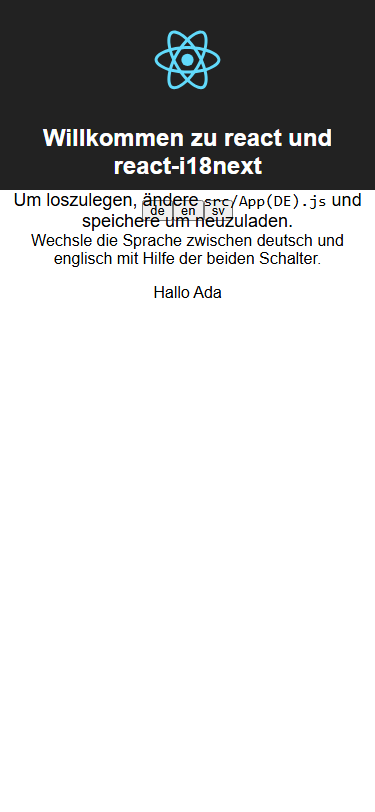
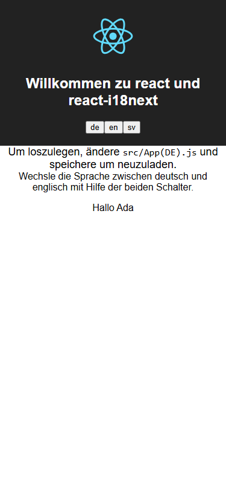

# v0.3 独立审查修复记录

本次只更新 Draft PR #7 的 `codex/v0.3-repair-engine`，基础仍为 `codex/v0.2-safe-apply`。修复前基线为 `194a1dc4af0705bf494b1e8ddaa4c53759a02be2`。先在未修改核心代码时逐项复现五个发现，再修改实现。PR #6、main 和 Release 不在本次写入范围。

## 发现与根因修复

| 发现 | 基线证据 | 实现与回归 |
| --- | --- | --- |
| P1-01 父子文字覆盖漏报 | `before/geometry.json` 的 ancestor、descendant 在两浏览器和两视口漏报 | 每个直接文本节点建立 Range，比较真实文字矩形；只排除控件自身标签的重复几何，不再整体跳过父子关系。`audit-visual.mjs`、`audit-real-apps.mjs` 同时验证异常父子覆盖及正常 strong/link 嵌套。 |
| P1-02 实色遮罩漏报 | 同报告 opaquePassive、partial 误通过 | 区分浏览器绘制顺序和点击命中。临时构造样式表只调整 pointer-events 以观察原绘制顺序，finally 恢复；多点采样输出覆盖比例。另用 Playwright trial click 验证可达性，并在可信框架用例实际点击、检查计数。空白实色层即使 pointer-events:none 仍报遮挡；无填充的装饰边框通过。无法可靠观察绘制顺序时报告环境错误并阻断。 |
| P2-01 修复丢失滚动 | `before/scroll.json`：修复被接受，但 clientHeight 增至 scrollHeight，实际 scrollTop 从 30 变为 0 | 不把正常 auto/scroll 的裁剪误诊为内容逃逸，且只从明确的作者固定高度生成候选。候选规则拒绝滚动声明/已观测滚动容器。独立前后交互门禁保留 overflow、两轴尺寸、位置、程序滚动和实际 wheel。共享类测试中，单元/视觉均通过的候选仍因 `SCROLL_CONTRACT_LOST` 拒绝，并按原字节回滚。review 阶段重新比较交互证据。 |
| P2-02 透明祖先误报 | geometry 的 transparentAncestor 被误报 | 有效 opacity 沿祖先相乘，同时检查 display/content-visibility；visibility 按实际子元素计算，保留 visibility:visible 覆盖隐藏祖先的真实异常。文字与滚动裁剪采用祖先可见区域。透明、display:none、visibility:hidden 负例和可见覆盖正例均跨浏览器执行。 |
| P2-03 Linux 遗留后代 | `before/process-v22.23.3.json`、`process-v24.22.0.json`：父进程正常退出后后代仍存活 | Linux 由 stdlib Python subreaper 保持所有权，收养孤儿并实际 kill/reap；适配器和 v0.3 修复专用单元验证均经过监督，单元结果接受前也必须完成回收。通过私有管道请求停止，信号用 pidfd 绑定内核身份，并重新核对后代关系。既不按进程名匹配，也不向已经退出的裸 PID/进程组发信号。并发/重复清理共用结果；无法证明清理成功时报告 PROCESS_CLEANUP_FAILED。真实测试包含父正常退出、超时、引擎父进程被杀、脱离会话的孙进程、单元测试留下的真实后代、重复清理、无关哨兵存活及 ESRCH（不能把僵尸算已清理）。v0.2 默认验证入口行为保留。 |

证据目录：[verification/v03-audit-remediation](verification/v03-audit-remediation)。JSON、截图、候选差异、回滚及平台回归输出由 `qa/export-audit-evidence.mjs` 从实际产物导出；私有临时路径已移除，原始产物仍保存在本机 artifacts。截图用于人工审核，程序通过与否以实际断言及报告为准。

## 真实应用与执行

沿用已锁定的 react-i18next Vite 和 next-i18next Next Pages Router 上游，普通页面仍执行原 v0.3 完整修复流程。另在隔离副本添加框架页面承载 14 组审查正反例，验证 Chromium/Firefox × 375/1280、实际德语/英语往返及按钮点击。Next 使用该项目支持的 locale 路由切换；最初仅调用 changeLanguage 的测试适配失败已记录，未删除语言断言。其全局 CSS 原有的整页溢出仍记录为阻断，审查区域的正反例单独断言，不能把区域通过解释为整页通过。失败断言及截图保留为 harness-failure。上游原文件摘要前后保持一致，依赖仍为显式可信安装。

首次远端审查修复 CI [40052029797](https://github.com/fangyuxu658-star/zeroloc-gate/actions/runs/40052029797/job/120746576437) 在 Linux Firefox 正常嵌套用例失败：该环境字体导致链接换行，整体 bounding rect 覆盖了两行之间的其他文字。根因修复改用控件实际的 `getClientRects()` 行片段，仍保留父子文字覆盖正例；新增 150px 宽的强制换行链接负例，并断言链接实际跨行。失败日志片段保存在 `after/ci-failure-40052029797.txt`，没有删除失败断言或豁免链接。

真实 React 原移动按钮/正文重叠继续自动修复成功；独立单元失败场景必须撤回。原 Next 页面已有的质量和离线外部资源错误继续阻断，不能以审查测试页通过代替原应用通过。P1 覆盖及不满足受限规则的 UI 不会擅自生成修改来制造通过。

本地回归结果保存在 `after/linux-node*.txt` 和 `after/windows-node*.txt`。新增几何矩阵 14×2 浏览器×2 视口全部符合预期；真实框架为 112 次区域断言，均检查英语/德语往返及滚动功能。最新框架本地证据使用 Windows Node 24.22.0；仍需独立核验目标 Node 22/24 的完整远端视觉矩阵。移动及宽视口的导出截图均有逐文件 SHA-256 清单。

同次远端 Windows Node22/24 真实应用在首次捕获前退出，原报告缺少定位信息。新增有界私有启动/执行日志；仅可信 CI 用例在失败时显示它们，生产报告和交付清单仍不含应用堆栈。隔离 TEMP 路径在传给框架之前调用 realpath，避免 Windows 8.3 别名与框架真实文件路径不一致；新增实际失败适配器的路径及阻断回归。该远端失败另存 `after/ci-failure-windows-40052029797.txt`，是否完全解决以随后当前 head 的真实 CI 为准。

后续 [40053067490](https://github.com/fangyuxu658-star/zeroloc-gate/actions/runs/40053067490) 证实 Windows React 修复通过，同时诊断出 Next 在 C 盘副本引用 D 盘依赖时生成 `./D:/...` Webpack 路径的真实错误。Windows 跨卷场景现使用项目父目录内独立的 `.zeroloc-repair-*` 同卷副本；不会改写原项目文件。副本位置及父目录指纹纳入默认预览和精确授权，父目录必须私有、可信且可写；无法创建时失败关闭。普通同卷及 Linux 仍用规范化的 OS 临时目录。本地真实 Vite 临时目录别名验证另存 `after/windows-temp-alias.txt`。新增跨卷选择回归保留原检查，完整框架行为以最终 CI 为准。

该运行 Windows Node22 的原工作流还出现正常按钮可达性失败。动作检查仍要求 Playwright 实际可见、稳定、启用且能命中；有界等待从 1 秒调整为 3 秒，并记录具体失败类别，不使用 force 或忽略遮挡。所有实色/透明拦截遮罩反例继续必须失败。失败原文分别保存在 `after/ci-failure-next-cross-volume-40053067490.txt` 和 `after/ci-failure-actionability-40053067490.txt`。

| 实际修复前 | 验证后的隔离副本 |
| --- | --- |
|  |  |

共享类的 candidate 截图看似正常，但滚动已丧失，因此拒绝并回滚；其 before/candidate/rollback 三阶段截图和指标均保留。P1 遮挡案例的语言往返截图仍显示缺陷，表示检测阻断证据，并非宣称已自动修好这些页面。

```sh
npm ci --ignore-scripts
npm test
npx --no-install playwright install --with-deps chromium firefox
node qa/audit-visual.mjs
node qa/audit-scroll.mjs
node qa/audit-scroll.mjs --shared-class
# 显式联网安装已锁定上游（需新的安装目录，沿用原 setup 约束）
npm run test:repair:setup
node qa/audit-real-apps.mjs
npm run test:repair -- --react-root artifacts/repair-upstream/react --next-root artifacts/repair-upstream/next
npm run test:repair -- --only react --scenario unit-failure --react-root artifacts/repair-upstream/react
npm run test:repair -- --only react --scenario semantic-block --react-root artifacts/repair-upstream/react
npm run test:repair -- --only react --scenario timeout --react-root artifacts/repair-upstream/react
```

`--record-baseline` 和 `audit-process-baseline.mjs` 仅用于上述历史版本；修复后普通命令断言所有新增预期。不要在修复后重新生成并覆盖历史失败证据。

CI 将既有四组 Windows/Linux × Node 22/24 回归保留，并把视觉工作扩为同样四组矩阵；均执行 Chromium 和 Firefox、原门禁、全部新增审查用例、真实框架及回滚/语义/超时场景。只读 GitHub 权限及固定 action 摘要保留。远端结果应查看 [PR #7 当前提交的检查](https://github.com/fangyuxu658-star/zeroloc-gate/pull/7/checks)，本地结果不替代远端结果。

## 保留的边界

- 默认预览、精确计划/执行/审核授权、v0.2 Safe Apply、备份、CAS 回滚及人工译文保护均保留；没有付费服务或远端模型调用。语义正确性仍为 unproven，`Hallo {{name}}, ` 回归继续执行。
- 仅可信、独占的隔离测试目录。适配器、Node 测试和共享依赖有同用户权限，目录复制和浏览器限制不是 OS 沙箱。滚动探针会触发实际 scroll/wheel 事件；通用点击采用 trial，不触发业务提交，真实点击仅用于可信测试页面。
- Linux 运行需要 `python3`、subreaper、pidfd_open/pidfd_send_signal 能力，启动时检查；缺失时失败关闭，不退回裸 PID 杀进程。测试不承诺抵抗同权限恶意代码、监督进程被 SIGKILL、系统崩溃或无法中断的内核任务。Windows 沿用对本次仍存活子进程的 taskkill /T，已退出且无所有权的进程拒绝猜测清理。
- 绘制检测仍有边界：多点采样不是逐像素证明；canvas、伪元素、背景图、Shadow DOM、跨源 iframe、复杂混合/滤镜、细小未采样覆盖及全部有意层叠没有完整建模。完全透明负例和正常边框通过不代表所有装饰都已覆盖；新增透明但拦截点击的遮罩必须阻断。控件 64、滚动区 32、DOM 5000、原子 800 超限均产生阻断性环境报告。
- 滚动契约使用同浏览器/视口/语言的稳定 DOM 路径匹配。结构变化会保守阻断；动态列表、滚动吸附和自定义手势还需要应用专用断言。不会将模型评分或一张截图当成语义/视觉正确性的证明。
